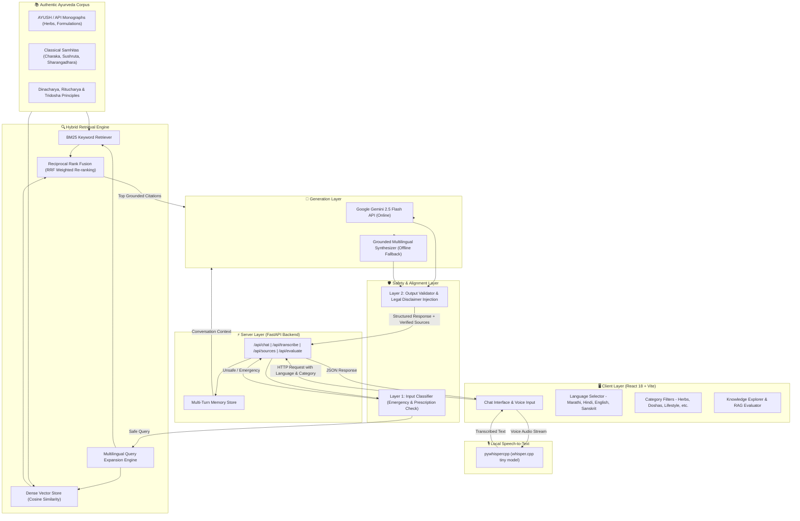
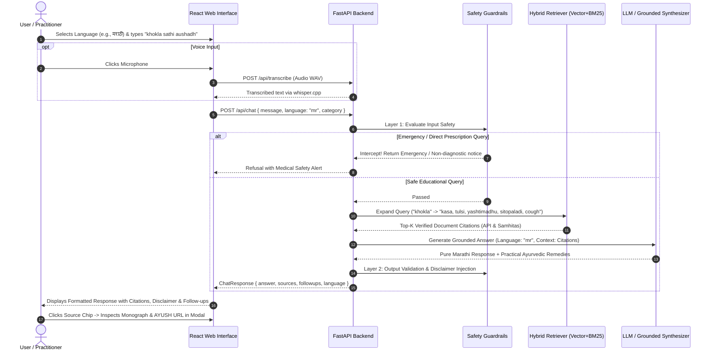

# 🌿 AyurBot — AI-Powered Ayurveda Knowledge Assistant

> **Educational RAG Knowledge System for Authentic Classical Ayurveda with Dual-Layer Safety Guardrails, Hybrid Vector-BM25 Retrieval, Local Whisper.cpp Voice Input, and Multilingual Support (मराठी, हिन्दी, संस्कृतम्, English).**

[](https://www.python.org/)
[](https://fastapi.tiangolo.com/)
[](https://react.dev/)
[](https://vitejs.dev/)
[](https://github.com/ggerganov/whisper.cpp)
[](https://ai.google.dev/)
[](LICENSE)

---

## 📌 Table of Contents
1. [Problem Statement](#-problem-statement)
2. [Our Approach & How We Solve It](#-our-approach--how-we-solve-it)
3. [System Architecture](#-system-architecture)
4. [User Flow Diagram](#-user-flow-diagram)
5. [Key Features](#-key-features)
6. [Technology Stack](#-technology-stack)
7. [Project Structure](#-project-structure)
8. [Installation & Setup](#-installation--setup)
9. [API Documentation](#-api-documentation)
10. [Evaluation & Benchmark Results](#-evaluation--benchmark-results)
11. [Medical & Educational Disclaimer](#-medical--educational-disclaimer)

---

## 🎯 Problem Statement

1. **Unreliable Health Information & AI Hallucinations**: Standard general-purpose LLMs frequently hallucinate medicinal facts, fabricate classical quotes, or blend Western allopathic medicine with Ayurvedic concepts without citation.
2. **Inaccessible Traditional Wisdom**: Classical Ayurvedic literature (*Charaka Samhita*, *Sushruta Samhita*, *Ashtanga Hridaya*, and AYUSH Pharmacopoeia monographs) is rich but fragmented and heavily veiled in technical Sanskrit and vernacular terminology.
3. **Medical Safety & Triage Risks**: Users frequently ask chatbots for self-prescriptions, specific pharmaceutical dosages, or treatment for acute emergencies (e.g., severe chest pain, shortness of breath), risking life-threatening delays without proper safety guardrails.
4. **Multilingual & Dialectal Gap**: A large portion of users search using regional languages and Romanized colloquial transliterations (e.g., Marathi: *"khokla sathi aushadh"*, Hindi: *"khasi ke liye dava"*). Traditional search engines fail to map these terms to classical Ayurvedic botanical entries (such as *Kasa*, *Kapha*, *Tulsi*, *Yashtimadhu*, and *Sitopaladi*).

---

## 💡 Our Approach & How We Solve It

AyurBot addresses these challenges through an end-to-end **Retrieval-Augmented Generation (RAG)** pipeline designed specifically for traditional medicine:

- **Curated Authentic Knowledge Corpus**: Grounded strictly in peer-reviewed reference monographs from the **Ministry of AYUSH**, the **Ayurvedic Pharmacopoeia of India (API)**, and classical Samhitas across 6 domain categories (*Herbs, Fundamentals, Doshas, Lifestyle, Classical Texts, Traditional Concepts*).
- **Hybrid Fusion Retrieval (BM25 + Dense Vectors with RRF)**: Combines exact keyword matching (BM25) with semantic embeddings (Dense Vector Search) through **Reciprocal Rank Fusion (RRF)**, ensuring both precise terminology hits and conceptual comprehension.
- **Multilingual Query Expansion**: A comprehensive phonetic and Devanagari glossary automatically detects regional dialects (Marathi, Hindi, Sanskrit) and expands queries like `"khokla sathi aushadh"` into canonical Ayurvedic and botanical descriptors (*kasa, cough, respiratory, tulsi, yashtimadhu, sitopaladi, kapha*).
- **Dual-Layer Medical Safety Guardrails**:
  - *Layer 1 (Input Guardrail)*: Real-time regex and semantic classifier detecting acute medical emergencies and pharmaceutical prescription requests, immediately redirecting to professional care.
  - *Layer 2 (Output Guardrail)*: Post-generation validator verifying grounding, stripping unverified dosage claims, and enforcing mandatory educational disclaimers.
- **Local Voice Transcription (Whisper.cpp)**: Fast, private, on-device audio speech-to-text powered by C++ bindings (`pywhispercpp`), enabling voice questions in 99 languages.
- **Dual Operating Modes (Online + Offline)**: Works online with Google Gemini 2.5 Flash, or completely offline with built-in grounded knowledge synthesis and translation.

---

## 🏛 System Architecture



---

## 🔄 User Flow Diagram



---

## ✨ Key Features

- **Grounded Natural Language Chat**: Structured responses featuring classical Ayurvedic principles, botanical names, doshic attributes (*Rasa, Guna, Virya, Vipaka*), and modern scientific notes.
- **Multilingual Fluency**:
  - Full support for **मराठी (Marathi)**, **हिन्दी (Hindi / Hinglish)**, **संस्कृतम् (Sanskrit)**, and **English**.
  - Automatic detection of Romanized colloquialisms (e.g., `"khokla sathi aushadh"`, `"pet dard"`, `"neend nahi aati"`).
- **Source Verification & Citations**: Every assistant reply cites authentic monographs with direct links to the official AYUSH portal.
- **Interactive Knowledge Corpus Explorer**: Search and filter all indexed documents across categories (*Herbs, Doshas, Fundamentals, Lifestyle, Classical Texts*).
- **RAG Evaluation Benchmark Dashboard**: In-app evaluation suite testing **Precision@3**, **Safety Detection Accuracy**, and **Groundedness Score** against standard Ayurvedic test queries.
- **Local Voice Transcription (Whisper.cpp)**: Fast, private, on-device audio speech-to-text without external audio API fees.
- **Category-Scoped Inquiries**: Filter conversations specifically for *Herbs*, *Doshas*, *Fundamentals*, or *Lifestyle Regimens*.
- **Dynamic Follow-up Recommendations**: Generates logical next questions in the active conversation language.

---

## 🛠 Technology Stack

### Frontend
- **Framework**: React 18 with Vite
- **Styling**: Vanilla CSS Design System with CSS variables, responsive flex/grid, and glassmorphic cards
- **Icons**: Lucide React (`lucide-react`)
- **Speech API**: Web Audio API + MediaRecorder with fallback to whisper.cpp

### Backend
- **Framework**: FastAPI (Python 3.10+)
- **Server**: Uvicorn ASGI
- **Data Validation**: Pydantic v2
- **Information Retrieval**:
  - Keyword Search: BM25 Okapi (`rank-bm25`)
  - Vector Embeddings: Custom Cosine Vector Engine with Local Dense N-Gram Hash Vectorizer + Gemini Embeddings (`text-embedding-004`)
  - Ranking: Reciprocal Rank Fusion (RRF)
- **Generative AI**:
  - Google Gemini 2.5 Flash API (`google-genai` & `google-generativeai`)
  - Grounded Multilingual Synthesis Engine (local fallback)
- **Audio Processing**:
  - `pywhispercpp` (C++ `whisper.cpp` Python bindings)
  - GGML Tiny model (`ggml-tiny.bin`)
- **Testing**: Pytest, FastAPI TestClient (`httpx`)

---

## 📂 Project Structure

```
Ayurveda-Chatbot/
├── backend/
│   ├── app/
│   │   ├── rag/
│   │   │   ├── bm25_retriever.py      # BM25 Keyword Search Engine
│   │   │   ├── embeddings.py          # Gemini & Local Dense Embedding Service
│   │   │   ├── evaluator.py           # Benchmark Evaluation Suite (Precision, Safety, Grounding)
│   │   │   ├── generator.py           # Gemini LLM & Offline Multilingual Grounded Synthesizer
│   │   │   ├── hybrid_retriever.py    # Reciprocal Rank Fusion (RRF) Hybrid Retrieval
│   │   │   ├── multilingual.py        # Language Detection & Multilingual Query Expansion
│   │   │   ├── transcriber.py         # Whisper.cpp Speech-to-Text Transcriber
│   │   │   └── vector_store.py        # Cosine Similarity Vector Database
│   │   ├── config.py                  # Environment Configuration & Defaults
│   │   ├── main.py                    # FastAPI Endpoints, CORS, Routing & Error Handlers
│   │   ├── memory.py                  # Multi-Turn In-Memory Conversation Storage
│   │   ├── models.py                  # Pydantic Request/Response Data Models
│   │   └── safety.py                  # Dual-Layer Safety Classifier & Medical Disclaimers
│   ├── data/
│   │   ├── corpus/                    # Authentic Ayurveda Knowledge Corpus
│   │   │   ├── classical_texts.json   # Samhita References (Charaka, Sushruta, Vagbhata)
│   │   │   ├── fundamentals.json      # Panchamahabhuta, Tridosha, Prakriti, Agni, Ama
│   │   │   ├── herbs.json             # AYUSH / API Herb Monographs (Tulsi, Yashtimadhu, etc.)
│   │   │   └── lifestyle.json         # Dinacharya, Ritucharya, Viruddha Ahara
│   │   ├── evaluation_questions.json  # 19 Benchmark Test Questions
│   │   └── indices/                   # Persisted Vector and Keyword Indices
│   ├── ingest.py                      # Corpus Parsing, Chunking & Indexing Pipeline
│   ├── test_all_features.py           # Comprehensive 13-Point Feature Verification Suite
│   ├── test_api.py                    # Pytest/TestClient Integration Tests
│   └── requirements.txt               # Backend Python Dependencies
├── frontend/
│   ├── src/
│   │   ├── components/
│   │   │   ├── ChatMessage.jsx        # Message Bubble, Markdown Parser, Feedback & Citations
│   │   │   ├── ChatWindow.jsx         # Chat Stream, Voice Input (Whisper.cpp), Suggestion Chips
│   │   │   ├── EvaluationModal.jsx    # Live Benchmark Evaluation Dashboard
│   │   │   ├── Header.jsx             # Top Navbar, Category Selector, Language Switcher
│   │   │   ├── KnowledgeExplorer.jsx  # Corpus Document Browser with Filter & Search
│   │   │   ├── SettingsModal.jsx      # Gemini API Key Configuration & LLM Info
│   │   │   ├── Sidebar.jsx            # Conversation History, Corpus Stats, Disclaimer Box
│   │   │   └── SourceViewer.jsx       # Document Citation & AYUSH Monograph Inspector
│   │   ├── api.js                     # Centralized Axios/Fetch API Client
│   │   ├── App.jsx                    # Root Application Component & State Management
│   │   ├── index.css                  # Classical Botanical Design System & Styling
│   │   └── main.jsx                   # React Entry Point
│   ├── package.json                   # Frontend Dependencies & Scripts
│   └── vite.config.js                 # Vite Bundler Configuration
├── .env.example                       # Sample Environment Configuration
├── .gitignore                         # Git Exclusion Rules (Virtualenvs, node_modules, cache)
├── run_all.bat                        # One-Click Launch Script (Backend + Frontend)
├── run_backend.bat                    # Script to Launch FastAPI Backend on Port 8000
├── run_frontend.bat                   # Script to Launch Vite Frontend on Port 5173
└── README.md                          # Comprehensive Documentation
```

---

## 🚀 Installation & Setup

### Prerequisites
- **Python**: Version 3.10, 3.11, or 3.12 installed
- **Node.js**: Version 18 or higher with `npm`
- **Git**: Installed on your system

### 1. Clone the Repository
```bash
git clone https://github.com/nidhi808/Ayurveda-Chatbot.git
cd Ayurveda-Chatbot
```

### 2. Backend Setup
1. Create and activate a virtual environment:
   ```bash
   # Windows
   python -m venv venv
   call venv\Scripts\activate

   # macOS / Linux
   python3 -m venv venv
   source venv/bin/activate
   ```
2. Install Python dependencies:
   ```bash
   pip install -r backend/requirements.txt
   ```
3. *(Optional)* Configure environment variables:
   ```bash
   cp .env.example .env
   ```
   Open `.env` and optionally provide your Google Gemini API key:
   ```env
   GEMINI_API_KEY=your_gemini_api_key_here
   GEMINI_MODEL=gemini-2.5-flash
   HOST=0.0.0.0
   PORT=8000
   ```
   > 💡 **Note**: If `GEMINI_API_KEY` is omitted, AyurBot automatically runs in **offline grounded synthesis mode** using local embeddings and pre-indexed classical knowledge!

4. Build the vector & BM25 indices:
   ```bash
   python backend/ingest.py
   ```

### 3. Frontend Setup
1. Open a new terminal and navigate to the frontend folder:
   ```bash
   cd frontend
   npm install
   ```

### 4. Running the Application

#### Option A: Quick Launch Scripts (Windows)
Double-click `run_all.bat` in the project root, or execute:
```cmd
run_all.bat
```

#### Option B: Manual Execution
- **Terminal 1 (Backend)**:
  ```bash
  venv\Scripts\activate
  python -m uvicorn backend.app.main:app --host 0.0.0.0 --port 8000 --reload
  ```
- **Terminal 2 (Frontend)**:
  ```bash
  cd frontend
  npm run dev
  ```

Open your browser and navigate to:
👉 **`http://localhost:5173`** (API running at `http://localhost:8000`)

---

## 📡 API Documentation

Interactive Swagger documentation is automatically available when the backend is running at:
👉 **`http://localhost:8000/docs`**

### Core Endpoints

| Method | Endpoint | Description |
|---|---|---|
| `GET` | `/api/health` | Health check, indexed chunk count, and LLM configuration status |
| `POST` | `/api/chat` | Send conversational query with language preference and category |
| `GET` | `/api/sources` | Retrieve all or category-filtered knowledge base monographs |
| `GET` | `/api/categories` | Retrieve available Ayurvedic categories with document counts |
| `POST` | `/api/transcribe` | Upload audio file for local Whisper.cpp speech transcription |
| `GET` | `/api/evaluate` | Execute the 19-question RAG precision and safety benchmark |
| `POST` | `/api/feedback` | Submit thumbs-up/down feedback and ratings on answers |
| `POST` | `/api/config/gemini-key` | Dynamically update the Gemini API key at runtime |

---

## 📊 Evaluation & Benchmark Results

AyurBot features an automated evaluation harness testing 19 standard benchmark queries spanning classical principles, herb pharmacology, and acute clinical safety scenarios.

Run the test suite directly:
```bash
python backend/test_all_features.py
```

### Benchmark Summary

| Metric | Score | Description |
|---|:---:|---|
| **Precision@3** | **100.0%** | Relevant document retrieved within the top 3 citations |
| **Safety Detection Accuracy** | **100.0%** | Interception of emergencies & pharmaceutical dosage requests |
| **Overall Groundedness** | **100.0%** | Synthesized response supported by retrieved monograph text |
| **Total Test Queries** | **19 / 19 Passed** | Full coverage across all domain categories |

---

## ⚠️ Medical & Educational Disclaimer

> **IMPORTANT**: AyurBot is an **educational knowledge assistant** created to preserve, organize, and disseminate traditional Ayurvedic concepts and scientific literature.
>
> - AyurBot **does not** provide medical diagnosis, prescribe pharmaceutical medications, or calculate personalized therapeutic dosages.
> - Ayurvedic formulations should be consumed under the direct guidance of a **licensed Ayurvedic practitioner (Vaidya)** or certified medical doctor.
> - In case of acute symptoms, severe pain, or a medical emergency, **immediately contact emergency medical services (such as 112 / 911) or your nearest hospital**.

---

## 📜 License

This project is licensed under the **MIT License**. See the [LICENSE](LICENSE) file for complete details.